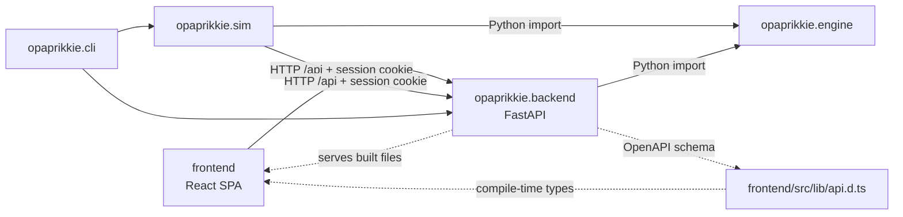

# Module dependencies

How the modules of Opa Prikkie relate: what each owns, what it may depend on, and how they talk.
Why it's shaped this way lives in the [ADRs](../adr/).

## Graph

## Modules

### `opaprikkie.engine`

- Owns the rules, board, dice, game state, turn resolution, seeded randomness, and built-in strategies.
- A library of pure functions over immutable state; it stores nothing ([ADR 0003](../adr/0003_stateless_engine_with_backend_sessions.md)).
- Depends on the standard library only; imports neither `backend` nor `sim`.
- Public surface: whatever `opaprikkie/engine/__init__.py` exports in `__all__`.

### `opaprikkie.backend`

- Owns the [HTTP API](http_api.md), the in-memory session store, the cookie, settings, and serving the built SPA.
- Wraps the engine: every state change is an engine call.
- Depends on `engine`, FastAPI, uvicorn, and pydantic-settings; doesn't import `sim`.

### `opaprikkie.sim`

- Owns batch runs, strategy matchups, the HTTP client, and aggregate statistics.
- Drives games either in-process through `engine` or over HTTP against a running backend.
- `run_batch` plays a matchup through a `GameDriver`: `InProcessDriver` calls the engine, `HttpDriver` an `httpx2.Client` pointed at a backend.
- `HttpDriver` checks `/api/health` first and fails fast unless the backend runs the same version in dev mode, since it sends each game's seed and first player.
- It plays each game in a new session with both seats `human`, so the logs match in-process ones, and maps a 422 rejection back to the engine's `IllegalAction`.
- Game `i` of a batch gets the seed `<batch seed>:<i>` and first player `i % players`, skipping the dice-off, so a batch seed replays the whole batch.
- Each seat's strategy gets its own `Random`, seeded from the game seed and the seat.
- A game's turns count both players' turns, the engine's turn number at the end.
- An `IllegalAction` from a strategy's choice ends the batch, with a note naming the strategy, seat, and game.
- Depends on `engine` and httpx2; never imports `backend` (tests may use it to exercise the HTTP path in-process).

### `opaprikkie.cli`

- The `opaprikkie` command: `serve` starts the backend, `simulate` runs batches.
- The only module that composes `backend` and `sim`.

### `frontend/`

- React SPA for hot-seat and human-versus-AI play.
- Talks to the backend only over HTTP, through a typed client generated from the backend's OpenAPI schema.
- Built into static files that the backend serves at `/`.

## Communication paths

| From | To | Through | Contract |
| -- | -- | -- | -- |
| frontend | backend | HTTP `/api`, same origin | generated `api.d.ts`, contract suite |
| sim | backend | HTTP `/api` | version handshake on `/api/health` |
| sim | engine | Python import | `engine.__all__` |
| backend | engine | Python import | `engine.__all__` |
| backend | frontend | static files from `OPAPRIKKIE_STATIC_DIR` | built `frontend/dist` |

## Enforcement

- `import-linter` contracts in `task lint_imports` (part of `task check` and CI) encode the import rules above.
- Change this document and the contracts together.
