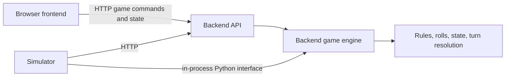

# Opa Prikkie monorepo plan

## Destination

Create an execution-ready architecture and implementation plan for a local browser MVP, then implement it in a monorepo with a frontend, backend, and separate simulator.

The canonical decision map is [Opa Prikkie browser MVP Wayfinder map](https://github.com/RamsesKools/opaprikkie-simulator/issues/14). Its child issues hold open decisions and dependencies; this document provides stable project context.

## MVP scope

- Start a two-player game.
- Play against an AI opponent with a selectable strategy.
- Play two-player hot-seat in one browser.
- View player boards, the active player, dice results, and the game outcome.
- Run repeatable simulations with the simulator module.

The first milestone is local and ephemeral. Online multiplayer, accounts, durable game storage, public hosting, production operations, and a simulator frontend are outside this scope.

## Agreed architecture direction



The backend owns the authoritative rules, random rolls, game state, legal choices, and turn resolution. The HTTP API and the simulator's in-process Python interface use the same game engine so rules are not duplicated.

A turn presents the current board, the initial dice roll, and legal target counts. A player or strategy chooses one target; the backend resolves the remaining rolls and returns the updated state. The backend provides built-in strategies by name, while a caller may supply its own strategy through the same choice contract.

The existing Python engine is a behavior reference. Compare it with the published rules, then decide each discrepancy individually. Keep the engine and simulator in Python. The browser frontend is a React single-page app that uses the backend over HTTP ([ADR 0001](../adr/0001-react-spa-frontend.md)).

## Decisions and research

- The turn action is choosing one legal target from the backend's initial observation; the backend resolves the rest of the turn. The game session is ephemeral.
- Built-in and caller-owned strategies use the same engine choice operation through HTTP or the in-process Python interface. The exact strategy payload and rejection behavior still need a decision.
- The frontend is a React SPA (Vite, TypeScript), chosen over SvelteKit and NiceGUI after comparing playable prototypes of the same flow ([#6](https://github.com/RamsesKools/opaprikkie-simulator/issues/6), [ADR 0001](../adr/0001-react-spa-frontend.md)).
- Rule research found four gameplay questions for individual decisions: [starting player](https://github.com/RamsesKools/opaprikkie-simulator/issues/15), [opening roll reuse](https://github.com/RamsesKools/opaprikkie-simulator/issues/16), [continuing after a peg reaches the top](https://github.com/RamsesKools/opaprikkie-simulator/issues/17), and [no movable target](https://github.com/RamsesKools/opaprikkie-simulator/issues/18). The physical peg-count difference is setup inventory. The board display's top/bottom indexing is an implementation bug to include in the later work breakdown.
- Research reports: [rules](https://github.com/RamsesKools/opaprikkie-simulator/issues/4) and [frontend candidates](https://github.com/RamsesKools/opaprikkie-simulator/issues/5).

## Monorepo shape to validate

```text
apps/
  backend/       HTTP API and authoritative Python game engine
  web/           browser game (React SPA)
  simulator/     batch runner, strategy callers, and backend clients
```

The backend may be used over HTTP or through its Python interface. The simulator should support both paths. The browser uses the backend API for the MVP.

## Route to implementation

1. Resolve the rule decisions from the published-rules comparison.
2. Select the stack and workspace layout around the React frontend.
3. Define the backend package boundary, game-session contract, and built-in and external strategy interfaces.
4. Benchmark HTTP and in-process simulation, then choose a default while retaining both modes.
5. Break the settled architecture into implementation issues for engine extraction, API, simulator, browser flows, and local development.

The migration should preserve the existing CLI until the replacement backend and simulator paths cover its useful behavior.

## MVP acceptance

- The backend is the only implementation of game rules and state transitions.
- A complete hot-seat game can be played in one browser.
- A complete human-versus-AI game can be played with a selectable strategy.
- The simulator can run seeded batches through both supported backend interfaces and report reproducible results.
- Local setup and run commands are documented for the web app, backend, and simulator.
